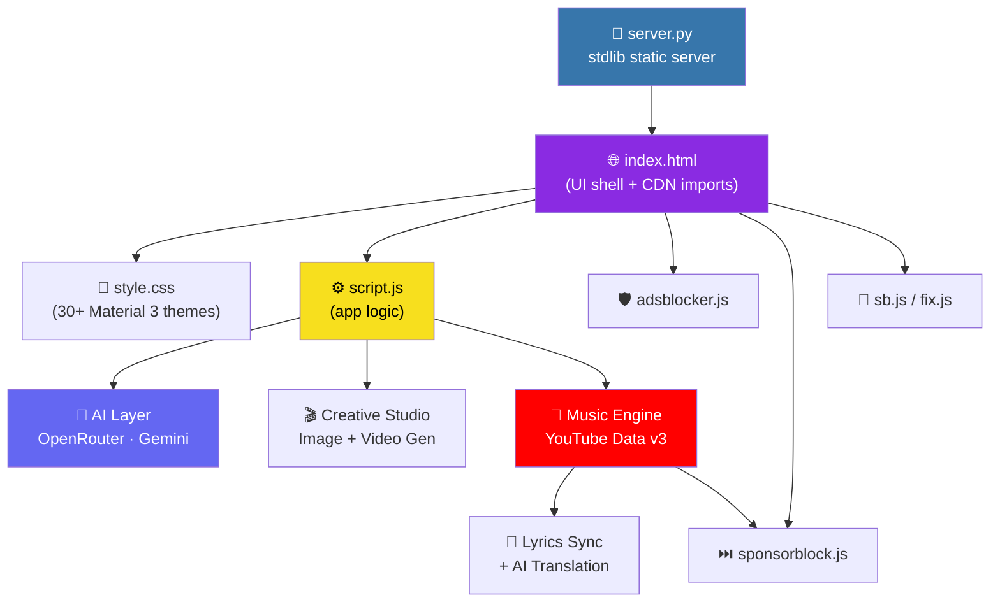

### 🔱 HEX AI — Open-Source AI Multimedia Companion (Web App / PWA)

**Chat · Generate Images · Animate Videos · Stream Music — all in one workspace.**

<sub>Built with 🖤 by <b>HexSleuth</b> (𓋹•HexSleuth•𓃠)</sub>

<br />

<!-- ─── Realtime primary badges ─────────────────────────────────────────── -->
<p>
  <a href="https://github.com/HexSleuth/hexai_webapp/stargazers">
    
  </a>
  <a href="https://github.com/HexSleuth/hexai_webapp/network/members">
    
  </a>
  <a href="https://github.com/HexSleuth/hexai_webapp/watchers">
    
  </a>
  <a href="https://github.com/HexSleuth/hexai_webapp/issues">
    
  </a>
  <a href="https://github.com/HexSleuth/hexai_webapp/pulls">
    
  </a>
  <a href="https://github.com/HexSleuth/hexai_webapp/commits/main">
    
  </a>
</p>

<p>
  <a href="https://github.com/HexSleuth/hexai_webapp">
    
  </a>
  <a href="https://github.com/HexSleuth/hexai_webapp/graphs/contributors">
    
  </a>
  <a href="https://github.com/HexSleuth/hexai_webapp/commits/main">
    
  </a>
  <a href="https://github.com/HexSleuth/hexai_webapp">
    
  </a>
  <a href="https://github.com/HexSleuth/hexai_webapp">
    
  </a>
  <a href="https://github.com/HexSleuth/hexai_webapp/blob/main/LICENSE">
    
  </a>
</p>

<!-- ─── Realtime: CodeQL workflow status ────────────────────────────────── -->
<p>
  <a href="https://github.com/HexSleuth/hexai_webapp/actions/workflows/codeql.yml">
    
  </a>
  <a href="https://github.com/HexSleuth/hexai_webapp/actions">
    
  </a>
  <a href="https://github.com/HexSleuth/hexai_webapp/security/policy">
    
  </a>
  
  
</p>

<!-- ─── Realtime: raw GitHub API (uncached-ish) counters ───────────────── -->
<p>
  
  
  
  
  
</p>

<!-- ─── Quick links ─────────────────────────────────────────────────────── -->
<p>
  <a href="#-key-features"><kbd>✨ Features</kbd></a>
  <a href="#-quick-start"><kbd>🚀 Quick Start</kbd></a>
  <a href="#-api-keys-setup"><kbd>🔐 API Keys</kbd></a>
  <a href="#-usage-guide"><kbd>🎮 Usage</kbd></a>
  <a href="#-contributing"><kbd>🤝 Contribute</kbd></a>
  <a href="https://github.com/HexSleuth/hexai_webapp/issues/new"><kbd>🐛 Report Bug</kbd></a>
  <a href="https://github.com/HexSleuth/hexai_webapp/issues/new"><kbd>💡 Request Feature</kbd></a>
</p>

</div>

---

## 📖 About

**HEX AI** is an open-source, browser-based **AI multimedia companion** — a Web App and installable **PWA** — that blends advanced artificial intelligence, generative creative tools, and uninterrupted music into one dynamic workspace.

Open HEX AI and a background track sets the mood, inviting you to **chat, create, and listen — seamlessly**. Everything (playlists, settings, volume, themes) is stored **100% locally** in your browser. No accounts. No tracking. No cloud storage of your data.

> 🔓 **Open source. Local-first. Privacy-respecting. Free to run.**

---

## ✨ Key Features

<table>
<tr>
<td width="50%" valign="top">

### 🤖 Multimodal AI Chat
- Chat with **free AI models** (OpenRouter / Gemini)
- Upload **Images** & **PDFs** for analysis
- **Voice input** for hands-free interaction
- Streaming responses & markdown rendering

### 🎨 Creative Studio
- Generate **stunning AI images**
- Create **short, animated looping AI videos**
- Style presets + aspect ratio control
- Send generated images straight into chat for analysis

</td>
<td width="50%" valign="top">

### 🎵 Built-in YouTube Music Player
- Search tracks & **import playlists by URL**
- Integrated **SponsorBlock** — auto-skips sponsored segments
- **Auto-sync lyrics** + **AI-powered translation**
- Customizable album art: **Spin / Video / None**
- Visualizer + volume memory

### 🫵😎 Delightful Details
- **Animated emojis** across the UI
- **30+ Material 3 themes**
- **Offline MP3** support
- **PWA installable** — works like a native app
- **Ad-blocker** built in

</td>
</tr>
</table>

---

## 📊 Live Repository Stats

> These cards update automatically on every page load. ⏱️

<div align="center">

| **Metric** | **Live Value** |
| :--- | :--- |
| ⭐ **Stars** |  |
| 🍴 **Forks** |  |
| 👀 **Watchers** |  |
| 🐛 **Open Issues** |  |
| 🔀 **Open PRs** |  |
| 🕐 **Last Commit** |  |
| 📈 **Commits / Month** |  |
| 👥 **Contributors** |  |
| 📦 **Repo Size** |  |
| 🧾 **License** |  |
| 🛡️ **CodeQL** |  |

<br />

### 📈 Commit Activity (last 12 months)


</div>

---

## 🧰 Tech Stack

<div align="center">


</div>

**Highlights**

- ⚡ **Zero backend dependencies** — `server.py` uses only the Python standard library
- 🎨 **30+ themes** built on Material 3 design tokens
- 🧩 **Modular scripts** — ad-blocker, SponsorBlock, lyrics sync, visualizer
- 🔐 **Local-first storage** — `localStorage` only, no server-side persistence
- 📴 **Offline capable** — PWA service worker + bundled offline MP3

---

## 🏗️ Architecture



---

🚀 Quick Start

Option 1 — Run Locally (recommended)

```bash
# 1. Clone the repo
git clone https://github.com/HexSleuth/hexai_webapp.git
cd hexai_webapp

# 2. Start the zero-dependency Python server
python server.py

# 3. Your browser opens automatically at:
#    http://localhost:8080
```

🐍 Requires Python 3.8+. No pip install needed — requirements.txt is intentionally empty.

Option 2 — Static Hosting

Because HEX AI is a pure static front-end, you can host the static/ folder anywhere:

```text
GitHub Pages  ·  Netlify  ·  Vercel  ·  Cloudflare Pages  ·  Any static host
```

Just point your host at the folder containing index.html.

Option 3 — Standalone Executable (PyInstaller)

```bash
# Install PyInstaller
pip install pyinstaller

# Build a single-file executable
pyinstaller --onefile --name "HEX_AI" \
  --add-data "static:static" \
  --add-data "server.py:." \
  server.py
```

🪟 Windows: use a semicolon separator → --add-data "static;static"
🍎🐧 macOS / Linux: use a colon separator → --add-data "static:static"

The binary appears in dist/HEX_AI (or dist\HEX_AI.exe).

---

📁 Project Structure

```text
hexai_webapp/
│
├── .github/
│   └── workflows/              # 🛡️ CodeQL security analysis workflow
│
├── static/                     # 🌐 The web application
│   ├── index.html              #    Main HTML (layout, CDN scripts, UI structure)
│   ├── style.css               #    All 30+ themes, Material 3 styling, music panel
│   └── script.js               #    Full app logic (chat, YouTube player, offline MP3, visualizer)
│
├── Adsblocke/                  # 🚫 Ad-blocker assets & filter lists
├── adsblocker.js               # 🛡️ Ad-blocking engine
├── sponsorblock.js             # ⏭️ SponsorBlock integration (auto-skip sponsors)
├── sb.js                       # ⚙️ SponsorBlock config (GitHub Pages support)
├── fix.js                      # 🔧 Patch / hotfix utilities
├── Minified.js                 # 📦 Minified production bundle
├── build-apk-from-url.js       # 📱 APK build configuration
│
├── index.html                  # 🏠 Root entry point
├── server.py                   # 🐍 Zero-dependency local server
├── requirement.text            # 📋 Dependencies (stdlib only)
├── SECURITY.md                 # 🔐 Security policy
└── README.md                   # 📖 You are here
```

---

🔐 API Keys Setup

HEX AI runs fully offline for the music player's default playlist, but to unlock its full potential you'll need a few API keys. Add them via the ⚙️ Settings (gear icon) inside the app.

Key Status Powers
YouTube Data v3 API Key 🔴 Required YouTube search & playlist imports
OpenRouter API Key 🟡 Highly Recommended AI chat, vision, image gen, lyrics translation
Google Gemini API Key 🟡 Highly Recommended AI chat, vision, video generation

<br />

<details>
<summary><b>🟣 1. OpenRouter API Key — for AI models</b> (click to expand)</summary>

1. Sign up: Go to OpenRouter and create an account using Email, Google, or GitHub.
2. Go to Keys: Click your profile picture (top-right) → select Keys.
3. Create a Key: Click Create API Key.
4. Configure & Generate: Give it a descriptive name (e.g. HEX-AI-App). Optionally set a credit limit or expiration date for security, or leave blank for unlimited usage. Click Create.
5. Copy the Key: ⚠️ Copy it immediately — it's only shown once!

</details>

<details>
<summary><b>🔵 2. Google Gemini API Key — for AI models</b> (click to expand)</summary>

1. Sign in: Go to Google AI Studio and sign in with your Google Account.
2. Accept Terms: Accept the terms of service and confirm your location if prompted.
3. Find the Menu: Click Get API key in the left-hand sidebar.
4. Generate: Click Create API key.
5. Link Project: Select an existing Google Cloud project (or create a new one), then click Create key.
6. Save it: Copy your new API key and store it securely.

</details>

<details>
<summary><b>🔴 3. YouTube Data v3 API Key — for the music player</b> (click to expand)</summary>

1. Go to the Google Cloud Console.
2. Create a new project (or select an existing one).
3. Navigate to APIs & Services → Library.
4. Search for YouTube Data API v3 and click Enable.
5. Go to APIs & Services → Credentials.
6. Click Create Credentials → API Key, then copy the generated key.

</details>

<br />

🔒 Security note: Keys are stored only in your browser's local storage and are sent directly from your browser to the respective providers. They never touch a HEX AI server (there isn't one).

---

🎮 Usage Guide

💬 Chatting

Type a message, use voice input, or attach images / PDFs. Press <kbd>Enter</kbd> or click send to get a response from your chosen AI model.

🖼️ Image Generation

1. Describe the scene you want.
2. Select your style and aspect ratio.
3. Click Generate.
4. Optionally send the result straight into chat for further analysis.

🎬 Video Generation

1. Enter a prompt.
2. Choose your desired duration.
3. Click Generate to turn an AI image into a short, looping animated video.

🎵 Music Player

A default playlist loads automatically on startup.

· ▶️ Click any song to play it.
· 🔍 Search YouTube for new tracks and add them instantly.
· 📥 Paste a YouTube Music playlist URL to import it.
· 🔁 Toggle Auto-Sync, AI Translation, and SponsorBlock via the player controls.
· 💿 Switch album art between Spin, Video, and None.

⌨️ Shortcuts

Key Action
<kbd>Enter</kbd> Send message
<kbd>Shift</kbd> + <kbd>Enter</kbd> New line
<kbd>Space</kbd> Play / Pause (when player focused)
<kbd>Esc</kbd> Close modals / settings

---

💾 Privacy & Persistence

HEX AI is local-first by design.

Stored Locally ✅ Never Stored ❌
Playlists & imported tracks Your chat history on any server
Volume & player settings Your API keys on any server
Selected theme Your uploaded images/PDFs
UI preferences & layout Any analytics or telemetry

Everything lives in your browser's localStorage. Clear it and you're back to a clean slate.

---

🗺️ Roadmap

☑ Multimodal AI chat (text + image + PDF)
☑ Voice input
☑ AI image generation
☑ AI looping video generation
☑ YouTube music player with playlist import
☑ SponsorBlock integration
☑ Auto-sync lyrics + AI translation
☑ 30+ Material 3 themes
☑ Ad-blocker
☑ PWA / offline support
☐ Plugin system for custom AI providers
☐ Multi-language UI (i18n)
☐ Native mobile app wrapper
☐ Shared "session" export / import

Have an idea? Open a feature request →

---

🤝 Contributing

Contributions are what make open source amazing! 🎉

```bash
# 1. Fork the repo
# 2. Create your feature branch
git checkout -b feature/AmazingFeature

# 3. Commit your changes
git commit -m "feat: add some AmazingFeature"

# 4. Push to the branch
git push origin feature/AmazingFeature

# 5. Open a Pull Request
```

Guidelines

· 🐛 Open an issue before starting major work
· ✅ Keep PRs focused — one feature/fix per PR
· 💅 Match the existing code style & Material 3 tokens
· 🔐 Never commit API keys or secrets
· 📝 Update the README if you change behavior

🐛 Found a Bug?

https://img.shields.io/badge/Report%20a%20Bug-FF7043?style=for-the-badge&logo=github&logoColor=white

Please include: browser + version, steps to reproduce, expected vs actual, and console errors if any.

---

🔐 Security

Please review our SECURITY.md for the full disclosure policy.

· 🛡️ CodeQL analysis runs automatically via GitHub Actions
· ⚠️ Do not open public issues for security vulnerabilities
· 📧 Report privately via GitHub Security Advisories

---

📄 License

Distributed under the terms of the license included in this repository.
See LICENSE for details.

https://img.shields.io/github/license/HexSleuth/hexai_webapp?style=for-the-badge&labelColor=0d1117&color=8BC34A

---

🙏 Acknowledgements

· OpenRouter — unified access to free & premium AI models
· Google Gemini — multimodal AI capabilities
· SponsorBlock — community-powered sponsor skipping
· YouTube Data API v3 — search & playlist data
· Material Design 3 — design system & theming
· Shields.io — the realtime badges in this README
· 💜 Every contributor and stargazer — you keep this project alive

---

<div align="center">

⭐ If HEX AI made your day better, drop a star!

<a href="https://github.com/HexSleuth/hexai_webapp/stargazers">
  
</a>
<a href="https://github.com/HexSleuth/hexai_webapp/fork">
  
</a>
<a href="https://github.com/HexSleuth/hexai_webapp/issues/new">
  
</a>

<br /><br />


<sub>𓋹•HexSleuth•𓃠 — <b>HEX AI</b> © 2026 · Open Source · Local-First · Privacy-Respecting</sub>

<br /><br />


</div>
```
### Realtime Badge System & Repository Snapshot

The badge suite turns the README into a live dashboard. Shields.io pulls directly from GitHub's API on each page load, so stars, forks, issues, and commit activity update without touching the markdown.

Badge groups at a glance:

· Primary badges — Stars, forks, watchers, issues, PRs, and last commit shown with for-the-badge styling for visual prominence.
· Workflow status — CodeQL and Build badges query GitHub Actions in real time, displaying pass/fail state with color coding.
· Dynamic JSON counters — Five badges use the dynamic/json endpoint to fetch raw GitHub API fields (e.g., stargazers_count, forks_count, size) with custom labels and colors.
· Visitor counter — A komarev.com badge tracks page views on this README.
· Commit graph — A github-readme-activity-graph embed renders 12 months of commit history as an area chart.

Repository details below the fold — The README also documents the zero-dependency Python server (server.py), 30+ Material 3 themes, SponsorBlock integration, AI provider setup (OpenRouter, Gemini, YouTube Data v3), local-first storage, and PyInstaller packaging. The architecture diagram uses Mermaid and maps out how the static front-end, AI layers, and music engine connect.

---

Optimization Tip: The CodeQL badge URL points to codeql.yml; if your workflow file has a different name, update both badge links. You can also replace main with your default branch name if needed.
